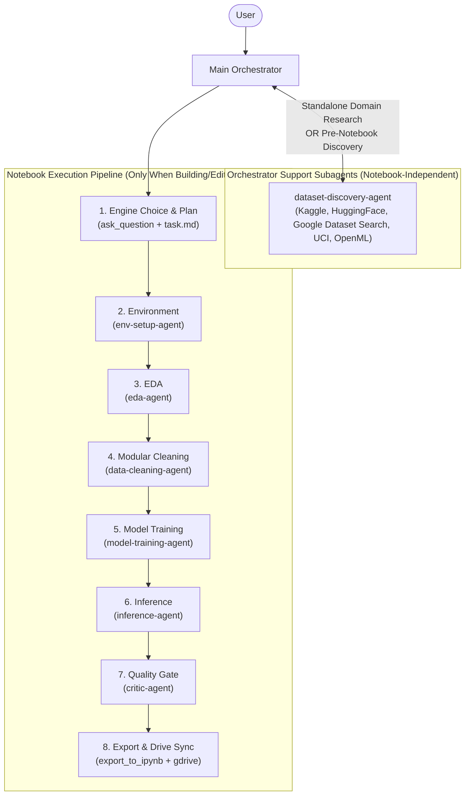

# Colab Data Scientist Skill

A complete data science and machine learning workflow methodology for your coding agents in Google Colab, built on top of a set of specialized subagents, interactive browser runtime execution, and automated Google Drive synchronization.

## Table of Contents

- [How it works](#how-it-works)
- [Installation](#installation)
  - [Antigravity](#antigravity)
- [The Basic Workflow](#the-basic-workflow)
- [What's Inside](#whats-inside)
  - [Specialist Subagents](#specialist-subagents)
  - [Scripts & Utilities](#scripts--utilities)
- [Tooling & Configuration](#tooling--configuration)
  - [Google Colab MCP](#1-google-colab-mcp-colab-mcp)
  - [Google Drive Sync](#2-google-drive-sync-gdrive)
- [When Something Goes Wrong](#when-something-goes-wrong)
- [Philosophy](#philosophy)
- [Acknowledgements](#acknowledgements)
- [License](#license)

## How it works

It starts the moment you ask your agent to build, run, or debug a notebook in Google Colab. As soon as it sees that you're working on a data science task, it *doesn't* just jump into generating ad-hoc code cells.

Instead, the **Main Orchestrator** steps back and writes a clear task checklist (`task.md`) tailored to your specific goal (e.g. *EDA-only*, *Pretrained Inference*, or *Full Training Pipeline*).

Once the plan is in place, the Orchestrator connects to Google Colab via `colab-mcp` and dispatches domain-specific subagents sequentially:
1. First, an environment specialist inspects the repository and runtime hardware to resolve dependencies and conflicts.
2. Next, data analysis and preprocessing specialists inspect distributions, catch outliers, and construct leak-free data splits.
3. Then, training and inference specialists execute models, generate dual diagnostic/boundary visualizations, and log evaluation metrics.
4. Before finishing, an end-of-notebook critic performs an automated quality audit, automatically repairing common warnings, unrendered figures, and seed discrepancies.
5. Finally, the notebook is assembled into a valid `.ipynb` file (preserving cell outputs) and synced directly to Google Drive.

Because subagents operate in safe, isolated read-only contexts while the Orchestrator serializes all Colab mutations, you get fast, reliable, reproducible notebooks without race conditions or hallucinated cell state.

## Installation

### Antigravity

Install this skill either globally across all your projects or scoped to a specific repository workspace.

#### Global Installation (Recommended)

To make the skill automatically available across all projects in Antigravity:

**macOS / Linux**:
```bash
git clone https://github.com/obra/colab-data-scientist-skill.git ~/.gemini/config/skills/colab-data-scientist-skill
```

**Windows (PowerShell)**:
```powershell
git clone https://github.com/obra/colab-data-scientist-skill.git "$HOME\.gemini\config\skills\colab-data-scientist-skill"
```

Verify that `SKILL.md`, `agents/`, and `scripts/` exist inside `~/.gemini/config/skills/colab-data-scientist-skill/`.

#### Workspace-Level Installation

To scope the skill exclusively to a single project:

1. Create the project skills directory:
   ```bash
   mkdir -p .agents/skills
   ```
2. Clone or submodule this repository:
   ```bash
   git submodule add https://github.com/obra/colab-data-scientist-skill.git .agents/skills/colab-data-scientist-skill
   ```

Antigravity automatically discovers skills in `~/.gemini/config/skills/` and `.agents/skills/`, injecting their descriptions on demand.

## The Basic Workflow

The orchestration prevents your agent from producing messy, monolithic notebooks by enforcing structured phase gates:



- **Standalone Support Mode (No Notebook Required)**: If you just want to explore a domain and see what datasets exist across Kaggle, HuggingFace, Google Dataset Search, OpenML, or UCI, the Main Orchestrator runs `dataset-discovery-agent` standalone—without opening Colab or touching a notebook. When a query is broad or yields many diverse datasets, `dataset-discovery-agent` asks clarifying questions (`ask_question`) so **you** decide how to filter by modality, size, license, or task rather than the agent filtering silently on its own.
- **Notebook Execution Mode**: When a notebook is being created or edited, the Main Orchestrator optionally calls `dataset-discovery-agent` first (asking you which dataset to use via `ask_question`), clarifies your preferred dataframe engine (**Pandas**, **Polars**, **DuckDB**, or **PySpark**), and runs the required notebook specialists sequentially:
  1. **`task.md` Checklist**: Tracks phases as cells execute in Colab.
  2. **`env-setup-agent`**: Reads repo manifests (`requirements.txt`, `pyproject.toml`) and imports, installs the selected dataframe engine, checks Colab CPU/GPU/TPU hardware, and outputs safe installation cells.
  3. **`eda-agent`**: Inspects data shape, types/schema, missing values, duplicates, and prints the numbered column list (`df.columns` / `X.columns`) alongside exploratory distributions.
  4. **`data-cleaning-agent`**: Writes small, idempotent Python scripts (`scripts/clean_XX_<clarifying_name>.py`), saves intermediate dataset checkpoints after each major change (`< 100 MB` as `.csv`, `>= 100 MB` as compressed `.parquet`), requests user confirmation via Orchestrator (`ask_question`) before bulk zipping or background offloading, documents every change in `DATA_CLEANING_LOG.md` + transparent notebook Before/After summaries, and performs leak-free train/val/test splits.
  5. **`model-training-agent`**: Establishes a baseline model first, compares candidates via a structured experiment tracking table, trains models with progress logging, task-adaptive metric calculation, dual diagnostic/data-space plots, and feature attribution / explainability (SHAP / permutation importance).
  6. **`inference-agent`**: Reuses notebook models or prompts the user via `ask_question` for target checkpoint selection before writing prediction code.
  7. **`critic-agent`**: Reads all `<subagent_name>_tasks.md` files alongside the complete notebook and live execution outputs, writes `critic-agent_tasks.md`, audits compliance, experiment tracking, and explainability, applies `SAFE_AUTO_FIXES` automatically, and escalates architectural changes.
  8. **Export & Google Drive Sync**: Reconstructs a clean `.ipynb` combining code, markdown, and execution outputs (with terminal/ANSI output sanitization), then syncs the notebook, `scripts/`, intermediate datasets, and `DATA_CLEANING_LOG.md` to Google Drive (`Colab Notebooks`).
- **Per-Subagent Task & Insight Files (`<subagent_name>_tasks.md`)**: Every subagent writes its granular checklist, design rationale, and verification invariants to `<subagent_name>_tasks.md` (e.g., `eda-agent_tasks.md`, `data-cleaning-agent_tasks.md`), giving both the Main Orchestrator and `critic-agent` deep visibility into every phase's intent and execution completeness.

## What's Inside

### Specialist Subagents

Organized into two completely separate tiers inside [`agents/`](agents/):

#### 1. Orchestrator Support Subagents (`agents/support/`) — Notebook-Independent
Can be run completely standalone (without any notebook) to explore a domain, or called by the Main Orchestrator when preparing a notebook workflow:
- **[`dataset-discovery-agent`](agents/support/dataset-discovery-agent.md)**: Searches Kaggle, HuggingFace Datasets, Google Dataset Search (`https://datasetsearch.research.google.com/`), UCI ML Repository, OpenML, Zenodo, and PapersWithCode. Writes `dataset-discovery-agent_tasks.md`. Instead of silently filtering large or ambiguous search results on its own, it asks clarifying questions via the Orchestrator (`ask_question`) to narrow down by modality, size, task, or license, and returns a ranked, notebook-independent dataset report.

#### 2. Notebook Execution Subagents (`agents/notebook/`)
- **[`env-setup-agent`](agents/notebook/env-setup-agent.md)**: Writes `env-setup-agent_tasks.md`; handles hardware, repository inspection, package pins (including the chosen dataframe engine), and Colab version conflict resolution.
- **[`eda-agent`](agents/notebook/eda-agent.md)**: Writes `eda-agent_tasks.md`; performs dataframe-engine agnostic dataset loading, summary statistics, missingness inspection, feature indexing, and visual sanity checks.
- **[`data-cleaning-agent`](agents/notebook/data-cleaning-agent.md)**: Writes `data-cleaning-agent_tasks.md`; generates modular, idempotent Python cleaning scripts (`scripts/clean_XX_<clarifying_name>.py`), intermediate dataset checkpoints (`< 100 MB` CSV, `>= 100 MB` compressed Parquet), confirms offloading via `ask_question`, persistent `DATA_CLEANING_LOG.md` documentation + transparent notebook summaries, and leak-free train/val/test splits.
- **[`model-training-agent`](agents/notebook/model-training-agent.md)**: Writes `model-training-agent_tasks.md`; establishes the simplest or most common baseline model first (OLS, Logistic Regression, naive baseline) before training complex architectures, maintains a comparative experiment tracking table, handles estimator fitting, checkpoint persistence, evaluation metrics, dual visualization panels, and feature attribution / explainability (SHAP).
- **[`inference-agent`](agents/notebook/inference-agent.md)**: Writes `inference-agent_tasks.md`; performs standalone prediction, batch inference, and model loading.
- **[`critic-agent`](agents/notebook/critic-agent.md)**: Reads all `<subagent_name>_tasks.md` files and writes `critic-agent_tasks.md`; conducts post-execution review covering dataframe engine consistency, modular cleaning & zero leakage, experiment tracking, explainability plots, warnings, unrendered charts, broken imports, and random seed integrity.

### Scripts & Utilities

- **[`scripts/export_to_ipynb.py`](scripts/export_to_ipynb.py)**: Assembles a standard Jupyter/Colab `nbformat` v4 notebook by combining cell structures from `get_cells(includeOutputs=False)` with step output JSON files, with ANSI escape/progress cleaning and fuzzy cell ID matching, avoiding WebSocket payload limits.

### References & Guides

- **[`best-practices/notebook-best-practices.md`](best-practices/notebook-best-practices.md)**: Engineering guidelines for Google Colab notebooks (Markdown-before-code narrative, cell granularity, modular function extraction, `%%time` profiling, `Pathlib`, rich `printmd()` logging, reliable `!{sys.executable} -m pip install`, IPython `%debug` / `set_trace` checkpoints, seeds, early assertion checks, GPU memory management, and resumable Drive checkpointing).
- **[`best-practices/pandas-best-practices.md`](best-practices/pandas-best-practices.md)**: Reference guide with core pandas best practices (explicit schema contracts, avoiding chained indexing / `inplace=True` / `iterrows()`, vectorized operations, category dtypes, missing data handling, named `groupby` aggregations, explicit merge parameters, and profiling) linked to official [Pandas Documentation](https://pandas.pydata.org/docs/).
- **[`best-practices/data-science-libraries.md`](best-practices/data-science-libraries.md)**: Curated reference catalog of industry-standard Python libraries organized across 16 domains (dataframe engines, automated EDA, plotting, ML, deep learning, RL, bioinformatics/genomics, NLP/LLMs, OpenAI ecosystem, AI agent frameworks, computer vision, time series, XAI, experiment tracking, validation, and model serving).

## Tooling & Configuration

### 1. Google Colab MCP (`colab-mcp`)

The Main Orchestrator connects to active Google Colab tabs via [`colab-mcp`](https://github.com/googlecolab/colab-mcp). Add it to `~/.gemini/config/mcp_config.json`:

```json
{
  "mcpServers": {
    "colab-mcp": {
      "command": "uvx",
      "args": [
        "git+https://github.com/googlecolab/colab-mcp"
      ]
    }
  }
}
```

> **Windows Note**: If `uvx` is not in your global `PATH`, use the full path to `uvx.exe` (e.g. `"C:\\Users\\<YourUser>\\AppData\\Roaming\\Python\\Python314\\Scripts\\uvx.exe"`).

### 2. Google Drive Sync (`gdrive`)

For automatic synchronization into Google Drive:
- Ensure the `gdrive` skill is present in `~/.gemini/config/plugins/gdrive/` (or your local plugins directory).
- Notebooks are uploaded on first run and updated in-place on subsequent edits in the `Colab Notebooks` folder.

## When Something Goes Wrong

- **WebSocket Disconnects / Unknown Tool**: If Colab's idle WebSocket disconnects and tools return `Unknown tool`, call `open_colab_browser_connection` to reconnect.
- **Cell Output Truncation**: Never call `get_cells(includeOutputs=True)` on notebooks with plots or heavy outputs. The orchestrator calls `get_cells(includeOutputs=False)` and merges `run_code_cell` artifact files using `export_to_ipynb.py`.
- **Subagent Isolation & Task Traceability**: Subagents never invoke `colab-mcp` tools directly and use write tools strictly to log their granular plans and rationale to `<subagent_name>_tasks.md`, preventing race conditions while giving the Orchestrator and `critic-agent` complete visibility.
- **Targeting by Cell ID**: When referring to a specific cell through `<cellId>`, use `update_cell` directly rather than fetching the whole page via HTTP.

## Philosophy

- **Specialization Over Monoliths**: Dedicated specialist subagents yield cleaner, idiomatic code. Subagents can be updated SKILLS.MD files can be easily updated to add more context or new specialized agents can be created.
- **Strict Orchestrator Control**: Only one agent mutates live notebook state. Preventing subagents from directly invoking MCP tools eliminates race conditions.
- **Leak-Free by Default**: Preprocessing decisions must be fit strictly on training data.
- **Zero-Loss Output Persistence**: Plots, metrics, and data summaries should never vanish when exporting from Colab MCP to disk or Drive.

## Acknowledgements

Special thanks to [**Superpowers**](https://github.com/obra/superpowers) by [@obra](https://github.com/obra) for pioneering composable agentic skills, subagent-driven workflows, and disciplined development methodology that served as the key inspiration for this project's architecture and design.

## License

This project is licensed under the MIT License - see the [LICENSE](file:///LICENSE) file for details.
