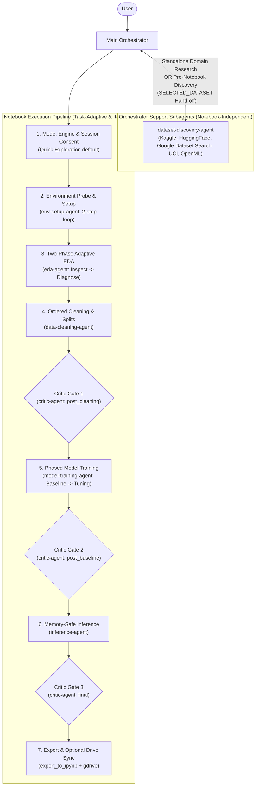

# Colab Data Scientist Skill

A complete data science and machine learning workflow methodology for coding agents in Google Colab, built on specialized subagents, interactive browser runtime execution with iterative error feedback, task-adaptive modeling across modalities, multi-gate quality auditing, and consent-driven Google Drive synchronization.

## Table of Contents

- [How it works](#how-it-works)
- [Installation](#installation)
  - [Antigravity](#antigravity)
- [The Basic Workflow](#the-basic-workflow)
- [What's Inside](#whats-inside)
  - [Specialist Subagents](#specialist-subagents)
  - [References & Operational Guides](#references--operational-guides)
  - [Scripts & Utilities](#scripts--utilities)
- [Tooling & Configuration](#tooling--configuration)
  - [Google Colab MCP](#1-google-colab-mcp-colab-mcp)
  - [Google Drive Sync](#2-google-drive-sync-gdrive)
- [When Something Goes Wrong](#when-something-goes-wrong)
- [Philosophy](#philosophy)
- [Acknowledgements](#acknowledgements)
- [License](#license)

## How it works

When you ask your agent to discover datasets or build, run, or debug a notebook in Google Colab, the **Main Orchestrator** sets up a structured workflow tailored to your task:

1. **Upfront Alignment (`ask_question`)**: The Orchestrator confirms your **Workflow Mode** (**`Quick Exploration`** by default for fast, low-ceremony inline code, or **`Polished Deliverable`** for full Markdown narratives, modular `scripts/clean_*.py` scripts, and intermediate checkpoints), your preferred dataframe engine (**Pandas**, **Polars**, **DuckDB**, or **PySpark**), training time quota, and asks **once per session** whether to enable Google Drive synchronization.
2. **Existing Notebook Inventory**: If attaching to an existing notebook, the Orchestrator inspects existing cells via `get_cells(includeOutputs=False)`, summarizes what already exists, and skips completed phases.
3. **Sequential Specialist Dispatch & Two-Phase Flow**: Subagents write their plan and invariants to `<subagent_name>_tasks.md` and return structured payloads:
   - `eda-agent` executes in two phases: probe & inspect first, then schema-aware visualizations and diagnostics.
   - `model-training-agent` executes phased training: establishes a fast baseline first, reports timing and validation score, and scales candidate tuning within your compute budget.
4. **Task-Adaptive Pipeline**: EDA, preprocessing, baselines, metrics, and visualizations automatically adapt to the task modality (**Tabular**, **NLP/LLM**, **Computer Vision**, **Time Series**, **Reinforcement Learning**, or **Unsupervised**).
5. **Multi-Gate Scoped Critic Gates (`critic-agent`)**: Rather than a single post-mortem at the very end, `critic-agent` is invoked across 3 scoped checkpoints:
   - `post_cleaning`: Audits split independence, zero train/val leakage, and destructive operation guardrails.
   - `post_baseline`: Audits baseline metric sanity and triggers the "too good" tripwire before candidate tuning begins.
   - `final`: Audits mode compliance, reproducibility, labeled visualizations, and inference persistence.
   - *Fix tiers*: Only fast (`< 5s`), non-destructive leaf/display cell fixes qualify as `SAFE_AUTO_FIXES`; any change to training cells or upstream data-mutating cells is classified under `ESCALATED_FIXES` and requires user confirmation.
6. **Zero-Loss Export & Consent-Based Drive Sync**: The notebook is assembled into a valid `.ipynb` file (preserving outputs) via `scripts/export_to_ipynb.py` and synced to Google Drive if session Drive consent was granted.

## Installation

### Antigravity

Install this skill either globally across all your projects or scoped to a specific repository workspace.

#### Global Installation (Recommended)

To make the skill automatically available across all projects in Antigravity:

**macOS / Linux**:
```bash
git clone https://github.com/obra/colab-data-scientist-skill.git ~/.gemini/config/skills/colab-data-scientist-skill
```

**Windows (PowerShell)**:
```powershell
git clone https://github.com/obra/colab-data-scientist-skill.git "$HOME\.gemini\config\skills\colab-data-scientist-skill"
```

Verify that `SKILL.md`, `agents/`, `references/`, `best-practices/`, and `scripts/` exist inside `~/.gemini/config/skills/colab-data-scientist-skill/`.

#### Workspace-Level Installation

To scope the skill exclusively to a single project:

1. Create the project skills directory:
   ```bash
   mkdir -p .agents/skills
   ```
2. Clone or submodule this repository:
   ```bash
   git submodule add https://github.com/obra/colab-data-scientist-skill.git .agents/skills/colab-data-scientist-skill
   ```

Antigravity automatically discovers skills in `~/.gemini/config/skills/` and `.agents/skills/`, injecting their descriptions on demand.

## The Basic Workflow



- **Standalone Support Mode (No Notebook Required)**: Run `dataset-discovery-agent` standalone to search Kaggle, HuggingFace Datasets, Google Dataset Search, OpenML, and UCI without opening Colab. Uses official REST APIs and search fallbacks, deduplicates cross-hub mirrors, enforces an explicit search budget ($\le 10$ queries, $\le 15$ fetches), and extracts verified metadata (**License**, **Size**, **Last Updated Date**, and **Colab Secrets**). Hands off a reproducible `SELECTED_DATASET` payload to `eda-agent`.
- **Notebook Execution Mode**:
  1. **Mode, Engine & Session Consent**: Defaults to **`Quick Exploration`** mode (concise inline code, section headers only) unless **`Polished Deliverable`** mode is requested; asks once per session whether to sync artifacts to Google Drive.
  2. **`env-setup-agent`**: Probes the live environment in Step 1, resolves dependencies, pins packages, configures `google.colab.userdata` secrets, sets global random seeds (`SEED = 42`), logs core library versions, and executes kernel restarts safely when C-extensions are upgraded.
  3. **`eda-agent`**: Executes in two adaptive phases (Phase 1: probe shape, types, missingness, and head samples; Phase 2: schema-aware diagnostics, distributions, correlations, and target leakage flags).
  4. **`data-cleaning-agent`**: Follows an ordered cleaning playbook (sentinels $\rightarrow$ types $\rightarrow$ categories $\rightarrow$ deduplication $\rightarrow$ bounds $\rightarrow$ missingness $\rightarrow$ outliers). Deduplicates before splitting, asserts zero group or split overlap, logs per-column modifications, and exports split checkpoints as Parquet along with an unfitted preprocessing pipeline.
  5. **Critic Gate 1 (`scope: "post_cleaning"`)**: `critic-agent` audits split independence, zero data leakage, and destructive operation thresholds ($> 5\%$ row drops) before any training compute is spent.
  6. **`model-training-agent`**: Runs phased training within a user-confirmed compute budget. Phase 1 trains a fast baseline estimator and reports duration and validation metrics. Phase 2 scales candidate tuning against the baseline. Emits `ADDITIONAL_PACKAGES` to the top setup cell if late dependencies arise.
  7. **Critic Gate 2 (`scope: "post_baseline"`)**: `critic-agent` audits baseline metric sanity, execution time, and evaluates the "too good" tripwire (`STATUS: "SUSPECTED_LEAKAGE"`) to catch target leakage early.
  8. **`inference-agent`**: Executes memory cleanup (`torch.cuda.empty_cache()`, `gc.collect()`), resilient model loading (in-memory with checkpoint fallback), train/serve schema skew assertions, batch prediction, and persists predictions to disk.
  9. **Critic Gate 3 (`scope: "final"`)**: `critic-agent` conducts a comprehensive final audit of mode compliance, plot formatting, and inference artifacts. Separates fast leaf fixes (`SAFE_AUTO_FIXES`) from user-escalated changes (`ESCALATED_FIXES`).
  10. **Export & Optional Drive Sync**: Reconstructs a clean `.ipynb` via `scripts/export_to_ipynb.py` and syncs to Google Drive if session Drive consent was enabled.

## What's Inside

### Specialist Subagents

Organized into two tiers inside [`agents/`](agents/):

#### 1. Orchestrator Support Subagents (`agents/support/`) — Notebook-Independent
- **[`dataset-discovery-agent`](agents/support/dataset-discovery-agent.md)**: Searches dataset hubs (API-first with search fallback), deduplicates mirrors, extracts verified metadata (license, raw vs. in-memory size, Colab secrets), enforces search budgets and early stopping, and delivers a clean `SELECTED_DATASET` hand-off payload.

#### 2. Notebook Execution Subagents (`agents/notebook/`)
Each notebook subagent writes its planning rationale and verification invariants to `<subagent_name>_tasks.md` and returns executable cells in a structured `CELLS_TO_EXECUTE` JSON array:
- **[`env-setup-agent`](agents/notebook/env-setup-agent.md)**: Two-step probe and plan loop, hardware checks, pinned dependency installation, `google.colab.userdata` secrets, global seeds, and restart recovery.
- **[`eda-agent`](agents/notebook/eda-agent.md)**: Two-phase adaptive EDA (probe & inspect $\rightarrow$ schema-aware diagnostics), dataset provenance logging, and anomaly/leakage detection.
- **[`data-cleaning-agent`](agents/notebook/data-cleaning-agent.md)**: Ordered cleaning playbook, per-column change logging, pre-split deduplication, group-aware splitting, Parquet checkpoints, and unfitted pipeline exports.
- **[`model-training-agent`](agents/notebook/model-training-agent.md)**: Phased training (baseline first $\rightarrow$ candidate tuning), compute/time quotas, train-vs-val overfitting checks, "too good" tripwire, and complete inference hand-off payloads.
- **[`inference-agent`](agents/notebook/inference-agent.md)**: Memory-safe cleanup, dual loading (memory + checkpoint fallback), train/serve skew assertions, and prediction persistence.
- **[`critic-agent`](agents/notebook/critic-agent.md)**: Mode- and task-aware quality critic operating across 3 scoped pipeline gates (`post_cleaning`, `post_baseline`, `final`), separating leaf display fixes (`SAFE_AUTO_FIXES`) from user-escalated training/data fixes (`ESCALATED_FIXES`).

### References & Operational Guides

- **[`references/colab-mcp-and-recovery.md`](references/colab-mcp-and-recovery.md)**: Operational reference for `colab-mcp` tools, existing notebook entry flow, iterative subagent execution/retry loop via `send_message`, and failure recovery protocols (kernel restarts, variable wipes, OOM/quota limits).
- **[`references/drive-sync-and-export.md`](references/drive-sync-and-export.md)**: Once-per-session Google Drive consent protocol, `.ipynb` export pipeline via `scripts/export_to_ipynb.py`, and Drive file ID collision/concurrent edit safety checks.
- **[`best-practices/notebook-best-practices.md`](best-practices/notebook-best-practices.md)**: Universal notebook standards (seeds, zero leakage, `userdata` secrets, labeled plots) alongside `Quick Exploration` vs. `Polished Deliverable` mode guidelines.
- **[`best-practices/pandas-best-practices.md`](best-practices/pandas-best-practices.md)**: Core pandas patterns (schema contracts, avoiding chained indexing/`iterrows()`, vectorized operations, and explicit merge validations).
- **[`best-practices/data-science-libraries.md`](best-practices/data-science-libraries.md)**: Curated reference catalog of Python libraries across 28 domains with exact `pip package` names, engine compatibility tags (`pandas`/`polars`/`both`), Colab runtime notes, profiling tools, and a line-index map for targeted line-range inspection.

### Scripts & Utilities

- **[`scripts/export_to_ipynb.py`](scripts/export_to_ipynb.py)**: Assembles a standard Jupyter/Colab `nbformat` v4 notebook by combining cell structures from `get_cells(includeOutputs=False)` with step output JSON files, including ANSI escape/progress bar cleaning and fuzzy cell ID matching.

## Tooling & Configuration

### 1. Google Colab MCP (`colab-mcp`)

The Main Orchestrator connects to active Google Colab tabs via [`colab-mcp`](https://github.com/googlecolab/colab-mcp). Add it to `~/.gemini/config/mcp_config.json`:

```json
{
  "mcpServers": {
    "colab-mcp": {
      "command": "uvx",
      "args": [
        "git+https://github.com/googlecolab/colab-mcp"
      ]
    }
  }
}
```

> **Windows Note**: If `uvx` is not in your global `PATH`, specify the full path to `uvx.exe` (e.g. `"C:\\Users\\<YourUsername>\\AppData\\Roaming\\Python\\Python314\\Scripts\\uvx.exe"`).

### 2. Google Drive Sync (`gdrive`)

For optional synchronization into Google Drive:
- Ensure the `gdrive` skill is present in `~/.gemini/config/plugins/gdrive/` (or your local plugins directory).
- The Orchestrator asks once per session before uploading or syncing any files to Google Drive.

## When Something Goes Wrong

- **WebSocket Disconnects / Unknown Tool**: If Colab's idle WebSocket disconnects and tools return `Unknown tool`, call `open_colab_browser_connection` to reconnect.
- **Runtime Disconnects / Variable Wipes**: If a cell fails with `NameError` on previously defined variables after a disconnect, re-run from the setup cell through the latest checkpoint cell rather than re-running multi-hour training from scratch.
- **Package Installs Requiring Kernel Restart**: When a C-extension or core library (`numpy`, `scipy`, `torch`, `pyarrow`) is upgraded (`requires_restart_after: true`), restart the runtime before running downstream import cells.
- **Cell Output Truncation**: Never call `get_cells(includeOutputs=True)` on notebooks with plots or heavy outputs because base64 image payloads exceed WebSocket buffer limits. Use `get_cells(includeOutputs=False)` and merge outputs via `scripts/export_to_ipynb.py`.

## Philosophy

- **Pragmatic Ceremony (`Quick Exploration` by Default)**: Fast, clean inline code for everyday exploration, with full modular scripts and narrative documentation available on demand in `Polished Deliverable` mode.
- **Task-Adaptive Intelligence**: NLP, CV, Time Series, RL, and Tabular tasks each get domain-appropriate baselines, splits, metrics, and diagnostics.
- **Multi-Gate Quality Assurance**: Catching data leakage and metric tripwires early at the source (`post_cleaning`, `post_baseline`) rather than discovering them only after hours of tuning.
- **Strict Orchestrator Control with Iterative Feedback**: Only the Orchestrator mutates live notebook state, while subagents receive real execution outputs via `send_message` to self-correct errors.
- **Safe Quality Auditing**: Auto-fixes never silently re-run expensive training loops or invalidate downstream data state.

## Acknowledgements

Special thanks to [**Superpowers**](https://github.com/obra/superpowers) by [@obra](https://github.com/obra) for pioneering composable agentic skills, subagent-driven workflows, and disciplined development methodology that served as the key inspiration for this project's architecture and design.

## License

This project is licensed under the MIT License - see the [LICENSE](LICENSE) file for details.
