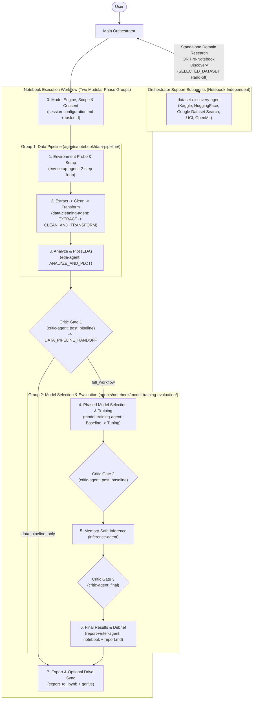

# Colab Data Scientist Skill

A complete data science and machine learning workflow methodology for coding agents in Google Colab, built around **two cohesive pipeline groups** (**Group 1: Data Pipeline** and **Group 2: Model Selection & Evaluation**), interactive browser runtime execution with iterative error feedback, Library-First task-adaptive modeling, multi-gate quality auditing, actionable results & debrief reporting, and consent-driven Google Drive synchronization.

## Table of Contents

- [How it works](#how-it-works)
- [Installation](#installation)
  - [Antigravity](#antigravity)
- [The Basic Workflow](#the-basic-workflow)
- [What's Inside](#whats-inside)
  - [Specialist Subagents](#specialist-subagents)
  - [References & Operational Guides](#references--operational-guides)
  - [Scripts & Utilities](#scripts--utilities)
- [Tooling & Configuration](#tooling--configuration)
  - [Google Colab MCP](#1-google-colab-mcp-colab-mcp)
  - [Google Drive Sync](#2-google-drive-sync-gdrive)
- [When Something Goes Wrong](#when-something-goes-wrong)
- [Philosophy](#philosophy)
- [Acknowledgements](#acknowledgements)
- [License](#license)

## How it works

When you ask your agent to discover datasets or build, run, or debug a notebook in Google Colab, the **Main Orchestrator** coordinates two modular phase groups:

1. **Upfront Alignment (`ask_question`) & Session Configuration**: Confirms your **Workflow Mode** (**`Quick Exploration`** by default for fast, low-ceremony inline pipeline functions, or **`Polished Deliverable`** for full Markdown narratives, modular `scripts/pipeline_XX_<stage>.py` scripts, and intermediate checkpoints), preferred dataframe engine (**Pandas**, **Polars**, **DuckDB**, or **PySpark**), training time quota, active **Pipeline Scope** (`data_pipeline_only`, `full_workflow`, or `model_evaluation_resume`), and once-per-session Google Drive sync preference in `session-configuration.md`.
2. **Group 1 — Data Pipeline (`agents/notebook/data-pipeline/`)**: Treated as a first-class **pipeline** in both notebook code and Orchestrator execution, always running `env-setup` $\rightarrow$ `extract` $\rightarrow$ `clean` $\rightarrow$ `transform` $\rightarrow$ `analyze/plot` (EDA):
   - `env-setup-agent` probes `!pip list`, installs only missing packages, configures `userdata` secrets, and sets `SEED = 42`.
   - `data-cleaning-agent` runs in two steps: `EXTRACT` (immutable load, pinned provenance, raw schema/hygiene probe) $\rightarrow$ `CLEAN_AND_TRANSFORM` (composable `extract_data` / `clean_data` / `transform_data` pipeline functions + `Pipeline` objects, pre-split deduplication, leak-free splits saved to Parquet, `unfitted_pipeline` + train-fitted `preprocessor`).
   - `eda-agent` runs in a single focused pass (`ANALYZE_AND_PLOT`) on the cleaned/transformed splits, providing the Dataset Overview & 4-column Feature Glossary Text Cell, `train`-only target diagnostics, single-figure (`8x4`) plots, and modeling recommendations.
   - Audited at the Group 1 exit boundary by `critic-agent` (`scope: "post_pipeline"`), yielding `DATA_PIPELINE_HANDOFF` (or stopping cleanly if only the Data Pipeline was requested).
3. **Group 2 — Model Selection & Evaluation (`agents/notebook/model-training-evaluation/`)**:
   - `model-training-agent` runs Library-First phased training (`BASELINE` $\rightarrow$ `post_baseline` critic gate $\rightarrow$ `CANDIDATES_AND_TUNING` within compute quota) and exports an end-to-end `SELECTED_MODEL`.
   - `inference-agent` runs memory-safe loading (in-memory + checkpoint fallback), train/serve skew assertions, batch inference, and saves predictions to disk (`PREDICTIONS_PATH`).
   - `critic-agent` runs the `final` process audit (`SAFE_AUTO_FIXES` vs. user-confirmed `ESCALATED_FIXES`) before reporting.
   - `report-writer-agent` closes the run: treating executed notebook `cells` and live `outputs` as the authoritative source of truth (never running new experiments), it appends `## Results & Debrief` (model comparison table, variance-calibrated model recommendation, single-figure evidence plots with captions, error analysis, and retrospective debrief) and writes standalone `report.md`.
4. **Zero-Loss Export & Consent-Based Drive Sync**: Assembles a valid `.ipynb` file (preserving outputs) via `scripts/export_to_ipynb.py` and optionally syncs to a user-confirmed Google Drive path.

## Installation

### Antigravity

Install this skill either globally across all your projects or scoped to a specific repository workspace.

#### Global Installation (Recommended)

To make the skill automatically available across all projects in Antigravity:

**macOS / Linux**:
```bash
git clone https://github.com/obra/colab-data-scientist-skill.git ~/.gemini/config/skills/colab-data-scientist-skill
```

**Windows (PowerShell)**:
```powershell
git clone https://github.com/obra/colab-data-scientist-skill.git "$HOME\.gemini\config\skills\colab-data-scientist-skill"
```

Verify that `SKILL.md`, `agents/`, `references/`, `best-practices/`, and `scripts/` exist inside `~/.gemini/config/skills/colab-data-scientist-skill/`.

#### Workspace-Level Installation

To scope the skill exclusively to a single project:

1. Create the project skills directory:
   ```bash
   mkdir -p .agents/skills
   ```
2. Clone or submodule this repository:
   ```bash
   git submodule add https://github.com/obra/colab-data-scientist-skill.git .agents/skills/colab-data-scientist-skill
   ```

Antigravity automatically discovers skills in `~/.gemini/config/skills/` and `.agents/skills/`, injecting their descriptions on demand.

## The Basic Workflow



- **Standalone Support Mode (No Notebook Required)**: Run `dataset-discovery-agent` standalone to search Kaggle, HuggingFace Datasets, Google Dataset Search, OpenML, and UCI without opening Colab. Hands off a reproducible `SELECTED_DATASET` payload directly to Group 1 (`data-cleaning-agent`).
- **Group 1 — Data Pipeline (`agents/notebook/data-pipeline/`)**:
  1. **`env-setup-agent`**: Probes installed packages with minimal code (`!pip list`), installs only missing dependencies, configures `google.colab.userdata` secrets, sets `SEED = 42`, and handles C-extension kernel restarts safely.
  2. **`data-cleaning-agent` (`extract` $\rightarrow$ `clean` $\rightarrow$ `transform`)**: Phase 1 (`EXTRACT`) loads raw data immutably (`extract_data`), logs pinned provenance, and probes raw schema/nulls/sentinels/duplicates. Phase 2 (`CLEAN_AND_TRANSFORM`) constructs composable `clean_data` and `transform_data` pipeline stages, deduplicates before splitting, saves `train.parquet`/`val.parquet`/`test.parquet`, and exports `unfitted_pipeline` + train-fitted `preprocessor`.
  3. **`eda-agent` (`analyze/plot`)**: Executes in a single focused pass (`ANALYZE_AND_PLOT`) on cleaned/transformed splits, emitting the Dataset Overview & 4-column Feature Glossary Text Cell, running leak-free `train`-only diagnostics and single-figure (`8x4`) plots, and writing modeling recommendations to `eda-agent_tasks.md`.
  4. **Critic Gate 1 (`scope: "post_pipeline"`)**: `critic-agent` audits the complete Data Pipeline (composable pipeline code, provenance, zero split leakage, `> 5%` drop guardrails, Parquet checkpoints, 4-column Feature Glossary fact-checking, and plot formatting) before packaging `DATA_PIPELINE_HANDOFF`.
- **Group 2 — Model Selection & Evaluation (`agents/notebook/model-training-evaluation/`)**:
  5. **`model-training-agent`**: Consumes `DATA_PIPELINE_HANDOFF` (or resumed Group 1 checkpoints). Phase 1 trains a fast Library-First baseline; Phase 2 scales candidate selection and tuning within compute quota and exports `SELECTED_MODEL`.
  6. **Critic Gate 2 (`scope: "post_baseline"`)**: Audits baseline Library-First compliance, runtime sanity, and the "too good" leakage tripwire (`SUSPECTED_LEAKAGE` routes back to Group 1 `data-cleaning-agent`).
  7. **`inference-agent`**: Reclaims memory, loads `SELECTED_MODEL` resiliently (memory + checkpoint fallback), validates train/serve schema skew, runs batch prediction, and saves predictions (`PREDICTIONS_PATH`).
  8. **Critic Gate 3 (`scope: "final"`)**: Audits mode compliance, Library-First model integrity, evaluation/XAI plots, and inference persistence prior to reporting.
  9. **`report-writer-agent`**: Consumes executed notebook `cells` and live `outputs` as the authoritative source of truth (plus `critic-agent` status), appends `## Results & Debrief` (model comparison table, variance-aware selection rationale, single-figure evidence plots with captions, error analysis, and prioritized `-` bullet next steps), writes standalone `report.md`, and returns a concise summary to the Orchestrator without running new experiments.
  10. **Export & Optional Drive Sync**: Reconstructs a clean `.ipynb` via `scripts/export_to_ipynb.py` and prompts via `ask_question` before uploading to Google Drive (user-specified paths strictly take precedence).

## What's Inside

### Specialist Subagents

Organized into support discovery and two notebook phase groups inside [`agents/`](agents/):

#### 1. Orchestrator Support Subagents (`agents/support/`) — Notebook-Independent
- **[`dataset-discovery-agent`](agents/support/dataset-discovery-agent.md)**: Searches dataset hubs (API-first with search fallback), deduplicates mirrors, extracts verified metadata (license, size, last updated date, Colab secrets), and delivers `SELECTED_DATASET`.

#### 2. Group 1: Data Pipeline Subagents (`agents/notebook/data-pipeline/`)
- **[`env-setup-agent`](agents/notebook/data-pipeline/env-setup-agent.md)**: Two-step `!pip list` probe and missing-package setup loop, hardware checks, `google.colab.userdata` secrets, `SEED = 42`, and restart recovery.
- **[`data-cleaning-agent`](agents/notebook/data-pipeline/data-cleaning-agent.md)**: Two-phase `EXTRACT` $\rightarrow$ `CLEAN_AND_TRANSFORM` composable pipeline (`extract_data`, `clean_data`, `transform_data`), pinned provenance, per-column change log, pre-split deduplication, group/temporal splitting, Parquet checkpoints, and `unfitted_pipeline` + fitted `preprocessor`.
- **[`eda-agent`](agents/notebook/data-pipeline/eda-agent.md)**: Single-pass `ANALYZE_AND_PLOT` on cleaned/transformed splits, Dataset Overview & 4-column Feature Glossary Text Cell, leak-free `train`-only diagnostics, single-figure (`8x4`) plots, and Group 2 modeling recommendations.

#### 3. Group 2: Model Selection & Evaluation Subagents (`agents/notebook/model-training-evaluation/`)
- **[`model-training-agent`](agents/notebook/model-training-evaluation/model-training-agent.md)**: Library-First phased training (`BASELINE` $\rightarrow$ `CANDIDATES_AND_TUNING`), compute quotas, overfitting gap tracking, leakage tripwire, XAI, and `SELECTED_MODEL` hand-off.
- **[`inference-agent`](agents/notebook/model-training-evaluation/inference-agent.md)**: Memory cleanup, resilient model loading (memory + checkpoint fallback), train/serve skew assertions, p50/p95 latency benchmarks, and prediction persistence.
- **[`critic-agent`](agents/notebook/model-training-evaluation/critic-agent.md)**: Quality critic across 3 scoped pipeline gates (`post_pipeline`, `post_baseline`, `final`), empirical fact-checking against live outputs, and strict separation of `< 5s` leaf `SAFE_AUTO_FIXES` from user-escalated `ESCALATED_FIXES`.
- **[`report-writer-agent`](agents/notebook/model-training-evaluation/report-writer-agent.md)**: Final results & debrief writer grounded strictly in executed notebook `cells` and `outputs` and [`notebook-best-practices.md`](best-practices/notebook-best-practices.md), producing `## Results & Debrief`, single-figure evidence plots, error analysis, standalone `report.md`, and `ORCHESTRATOR_SUMMARY` without running new experiments.

### References & Operational Guides

- **[`references/colab-mcp-and-recovery.md`](references/colab-mcp-and-recovery.md)**: Operational reference for `colab-mcp` tools, two-group existing notebook entry flow, iterative subagent execution/retry loop via `send_message`, and failure recovery protocols (including Group 1 checkpoint boundary recovery).
- **[`references/drive-sync-and-export.md`](references/drive-sync-and-export.md)**: Once-per-session Google Drive consent protocol, pre-upload target path confirmation with user priority rule, `.ipynb` export pipeline via `scripts/export_to_ipynb.py`, and companion artifact sync (`report.md`, `scripts/pipeline_*.py`).
- **[`best-practices/notebook-best-practices.md`](best-practices/notebook-best-practices.md)**: Universal notebook standards (seeds, composable data pipeline, zero leakage, `userdata` secrets, single-figure labeled plots, Colab Markdown rules) alongside `Quick Exploration` vs. `Polished Deliverable` mode guidelines.
- **[`best-practices/pandas-best-practices.md`](best-practices/pandas-best-practices.md)**: Core pandas patterns (schema contracts, avoiding chained indexing/`iterrows()`, vectorized operations, and explicit merge validations).
- **[`best-practices/data-science-libraries.md`](best-practices/data-science-libraries.md)**: Curated reference catalog of Python libraries across 28 domains with exact `pip package` names, engine compatibility tags (`pandas`/`polars`/`both`), Colab runtime notes, and a line-index map for targeted line-range inspection.

### Scripts & Utilities

- **[`scripts/export_to_ipynb.py`](scripts/export_to_ipynb.py)**: Assembles a standard Jupyter/Colab `nbformat` v4 notebook by combining cell structures from `get_cells(includeOutputs=False)` with step output JSON files, including ANSI escape/progress bar cleaning and fuzzy cell ID matching.

## Tooling & Configuration

### 1. Google Colab MCP (`colab-mcp`)

The Main Orchestrator connects to active Google Colab tabs via [`colab-mcp`](https://github.com/googlecolab/colab-mcp). Add it to `~/.gemini/config/mcp_config.json`:

```json
{
  "mcpServers": {
    "colab-mcp": {
      "command": "uvx",
      "args": [
        "git+https://github.com/googlecolab/colab-mcp"
      ]
    }
  }
}
```

> **Windows Note**: If `uvx` is not in your global `PATH`, specify the full path to `uvx.exe` (e.g. `"C:\\Users\\<YourUsername>\\AppData\\Roaming\\Python\\Python314\\Scripts\\uvx.exe"`).

### 2. Google Drive Sync (`gdrive`)

For optional synchronization into Google Drive:
- Ensure the `gdrive` skill is present in `~/.gemini/config/plugins/gdrive/` (or your local plugins directory).
- The Orchestrator asks once per session before uploading or syncing any files to Google Drive.

## When Something Goes Wrong

- **WebSocket Disconnects / Unknown Tool**: If Colab's idle WebSocket disconnects and tools return `Unknown tool`, call `open_colab_browser_connection` to reconnect.
- **Runtime Disconnects / Variable Wipes**: If a cell fails with `NameError` in Group 2 after a disconnect, reload Group 1's persisted Parquet split checkpoints (`train.parquet`, `val.parquet`, `test.parquet`) and serialized pipelines rather than re-running Group 1 or multi-hour training from scratch.
- **Package Installs Requiring Kernel Restart**: When a C-extension or core library (`numpy`, `scipy`, `torch`, `pyarrow`) is upgraded (`requires_restart_after: true`), restart the runtime before running downstream import cells.
- **Cell Output Truncation**: Never call `get_cells(includeOutputs=True)` on notebooks with plots or heavy outputs because base64 image payloads exceed WebSocket buffer limits. Use `get_cells(includeOutputs=False)` and merge outputs via `scripts/export_to_ipynb.py`.

## Philosophy

- **First-Class Data Pipeline (`extract` $\rightarrow$ `clean` $\rightarrow$ `transform` $\rightarrow$ `analyze/plot`)**: Treating data preparation and exploratory analysis as a composable, checkpointed pipeline prevents ad-hoc state tangles and guarantees EDA reflects clean, transformed features without leakage.
- **Pragmatic Ceremony (`Quick Exploration` by Default)**: Fast, clean inline pipeline functions for everyday exploration, with modular `scripts/pipeline_XX_<stage>.py` scripts and full narrative documentation available on demand in `Polished Deliverable` mode.
- **Multi-Gate Quality Assurance + Honest Reporting**: `critic-agent` enforces process integrity (`post_pipeline`, `post_baseline`, `final`) before `report-writer-agent` synthesizes variance-calibrated conclusions and a transparent retrospective debrief.
- **Strict Orchestrator Control with Notebook as Source of Truth**: Only the Orchestrator mutates live notebook state, while subagents receive real execution outputs via `send_message` as the authoritative source of truth.

## Acknowledgements

Special thanks to [**Superpowers**](https://github.com/obra/superpowers) by [@obra](https://github.com/obra) for pioneering composable agentic skills, subagent-driven workflows, and disciplined development methodology that served as the key inspiration for this project's architecture and design.

## License

This project is licensed under the MIT License - see the [LICENSE](LICENSE) file for details.
